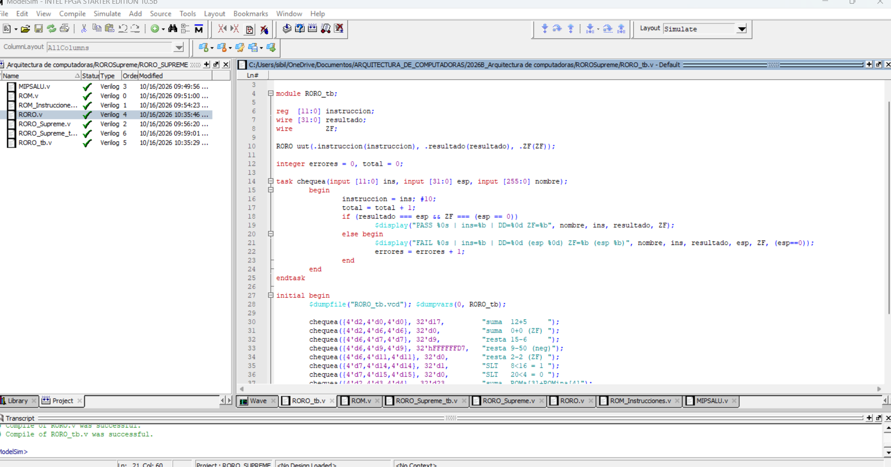
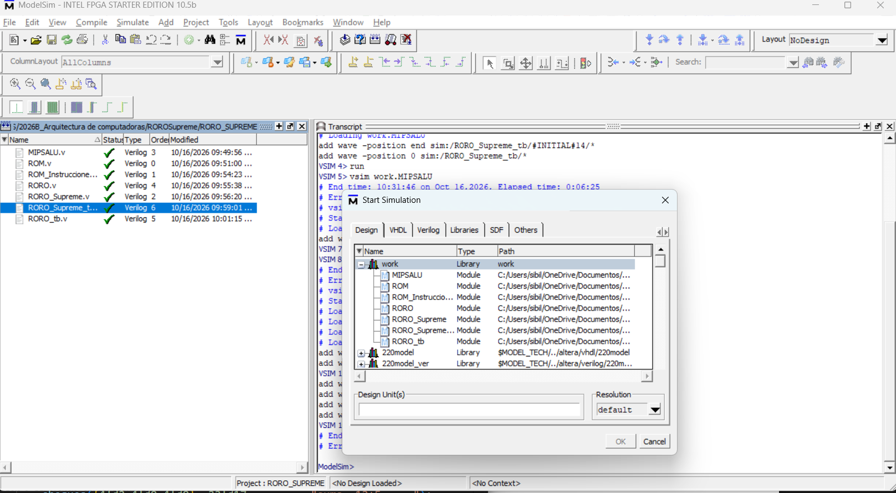
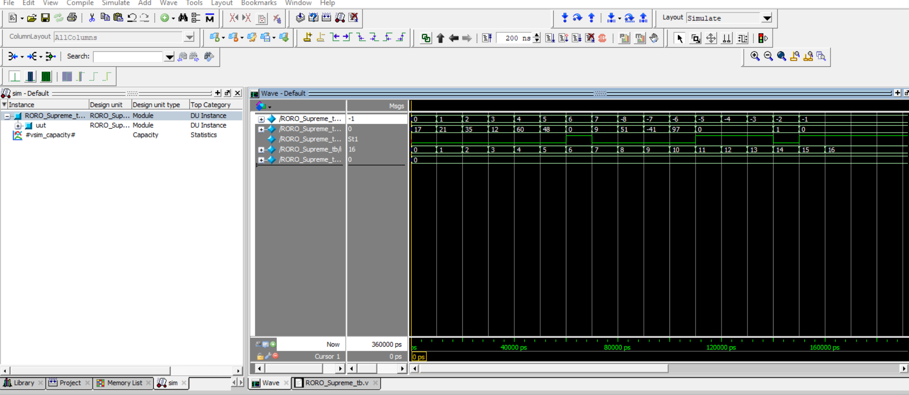
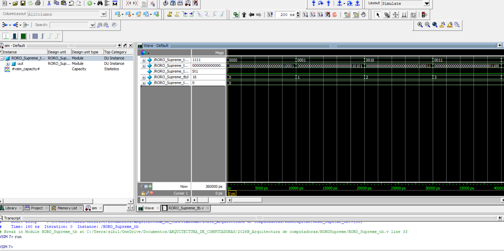
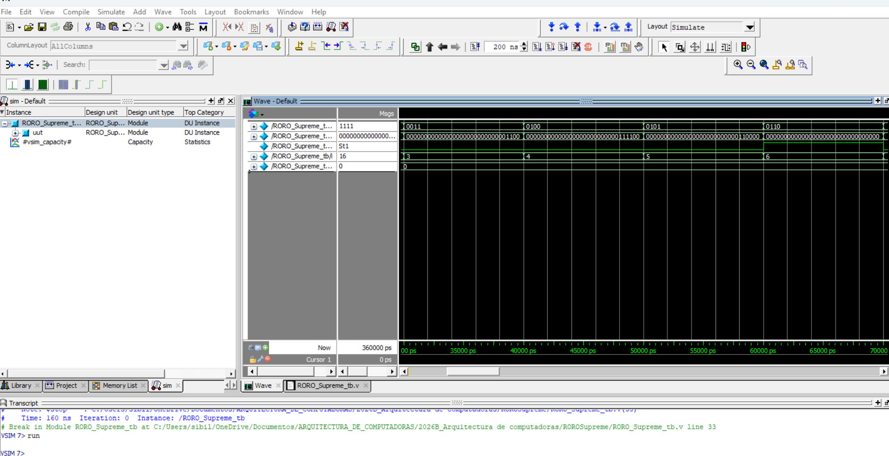
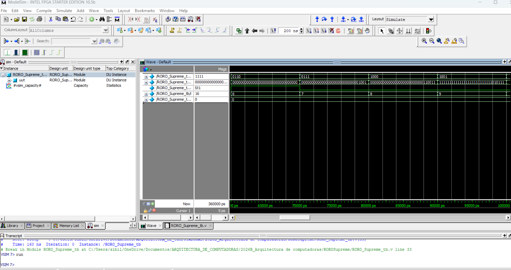
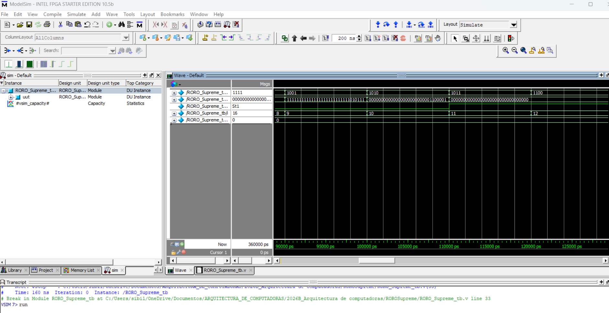
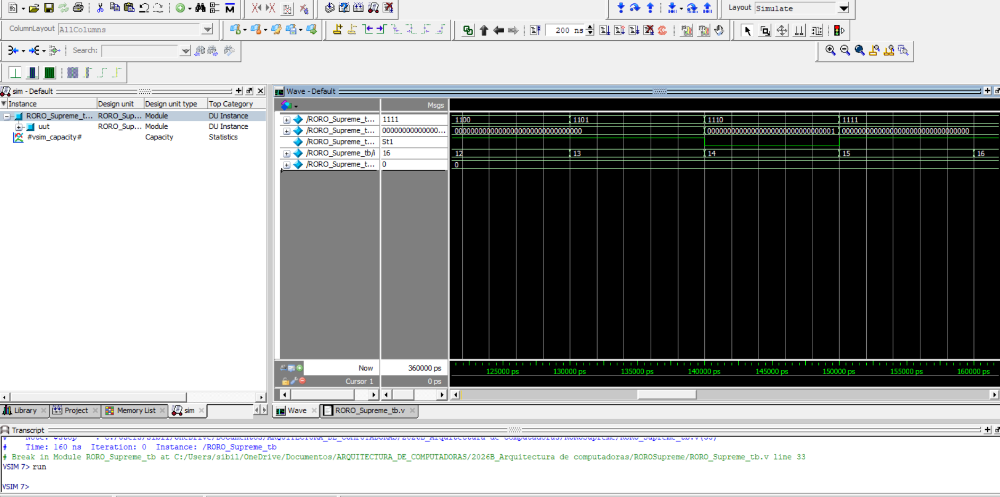

# Actividad RORO Supreme

**Universidad de Guadalajara · Arquitectura de Computadoras · INFO 2026B**

**Integrantes:**

- Hector Manuel Rios Avalos
- Kevin Ivan Castro Nieves
- Diego Ramirez Sanchez
- Sibilina Alejandra Julian Ramirez

**Reporte en PDF:** [Reporte_RORO_Supreme.pdf](Act4. Memorias e Instrucciones.pdf)

---

## 1. Objetivo

Diseñar el módulo superior **RORO Supreme**, que ejecuta una secuencia de 16 instrucciones de 12 bits. Para ello se reutilizan los módulos vistos en clase (`ROM`, `MIPSALU` y `RORO`), se crea una ROM de instrucciones y se desarrollan los testbenches que verifican el bloque RORO y el sistema completo.

## 2. Cómo funciona el sistema

Una dirección de 4 bits (`DirInst`), controlada por el testbench, selecciona una de las 16 instrucciones guardadas en la ROM de instrucciones. Cada instrucción tiene el formato:

```
 11      8 7      4 3      0
+---------+--------+--------+
|   OP    |   R1   |   R2   |
+---------+--------+--------+
```

- **OP** (4 bits) elige la operación de la ALU.
- **R1** (4 bits) es la dirección que se lee en la ROM `Roma` (operando A).
- **R2** (4 bits) es la dirección que se lee en la ROM `Romina` (operando B).

Ambas ROM entregan operandos de 32 bits a la ALU, que produce el resultado `DD[31:0]` y la bandera `ZF`, que vale 1 solo cuando `DD` es cero.

```
DirInst[3:0] → ROM_Instrucciones (16x12) → OP | R1 | R2
R1 → ROM Roma   (ROMa_init.txt)   ┐
                                  ├→ MIPSALU → DD[31:0], ZF
R2 → ROM Romina (ROMina_init.txt) ┘
OP ─────────────────────────────→ MIPSALU
```

Como R1 y R2 ya tienen 4 bits y las ROM tienen 16 posiciones, no fue necesario extender la dirección con ceros. No se implementó contador de programa: el testbench cambia `DirInst` directamente.

### Archivos del proyecto

| Archivo                                                 | Función                                                          |
| ------------------------------------------------------- | ---------------------------------------------------------------- |
| `ROM.v`                                                 | ROM de datos de 16 posiciones × 32 bits, cargada con `$readmemb` |
| `MIPSALU.v`                                             | ALU de clase, sin cambios                                        |
| `RORO.v`                                                | Integra dos ROM y la ALU                                         |
| `ROM_Instrucciones.v`                                   | ROM de 16 posiciones × 12 bits                                   |
| `RORO_Supreme.v`                                        | Módulo superior: ROM de instrucciones + RORO                     |
| `RORO_tb.v`                                             | Testbench del bloque RORO                                        |
| `RORO_Supreme_tb.v`                                     | Testbench de las 16 instrucciones                                |
| `ROMa_init.txt`, `ROMina_init.txt`, `instrucciones.txt` | Archivos de inicialización en binario                            |

## 3. Cambios a los módulos de clase

- **`ROM.v`**: la versión de clase tenía 9 posiciones con datos escritos en el código, por lo que las direcciones 9 a 15 daban valores indefinidos. Se amplió a 16 posiciones y se cargó desde archivo con `$readmemb`, usando un parámetro `FILE` para que `Roma` y `Romina` lean archivos distintos. Los puertos `DirL` y `Data` no cambiaron.
- **`RORO.v`**: solo se agregaron los parámetros `FILE_A` y `FILE_B` para pasar el nombre de archivo a cada ROM. Las conexiones son las mismas.
- **`MIPSALU.v`**: sin cambios. Se revisó su codificación: `0010` suma, `0110` resta y `0111` SLT (`A < B`).

## 4. Programa de 16 instrucciones

Se usan 6 sumas, 6 restas y 4 comparaciones SLT. En cada instrucción R1 = R2 = el índice, así que se recorren las 16 direcciones de ambas ROM.

| Dir | Instrucción      | OP  | R1  | R2  | ROMa | ROMina | Operación | DD esperado               | ZF    |
| --- | ---------------- | --- | --- | --- | ---- | ------ | --------- | ------------------------- | ----- |
| 0   | `0010 0000 0000` | 2   | 0   | 0   | 12   | 5      | suma      | 17                        | 0     |
| 1   | `0010 0001 0001` | 2   | 1   | 1   | 7    | 14     | suma      | 21                        | 0     |
| 2   | `0010 0010 0010` | 2   | 2   | 2   | 25   | 10     | suma      | 35                        | 0     |
| 3   | `0010 0011 0011` | 2   | 3   | 3   | 3    | 9      | suma      | 12                        | 0     |
| 4   | `0010 0100 0100` | 2   | 4   | 4   | 40   | 20     | suma      | 60                        | 0     |
| 5   | `0010 0101 0101` | 2   | 5   | 5   | 18   | 30     | suma      | 48                        | 0     |
| 6   | `0110 0110 0110` | 6   | 6   | 6   | 0    | 0      | resta     | 0                         | **1** |
| 7   | `0110 0111 0111` | 6   | 7   | 7   | 15   | 6      | resta     | 9                         | 0     |
| 8   | `0110 1000 1000` | 6   | 8   | 8   | 63   | 12     | resta     | 51                        | 0     |
| 9   | `0110 1001 1001` | 6   | 9   | 9   | 9    | 50     | resta     | 4294967255 (`0xFFFFFFD7`) | 0     |
| 10  | `0110 1010 1010` | 6   | 10  | 10  | 100  | 3      | resta     | 97                        | 0     |
| 11  | `0110 1011 1011` | 6   | 11  | 11  | 2    | 2      | resta     | 0                         | **1** |
| 12  | `0111 1100 1100` | 7   | 12  | 12  | 31   | 31     | SLT       | 0                         | **1** |
| 13  | `0111 1101 1101` | 7   | 13  | 13  | 55   | 11     | SLT       | 0                         | **1** |
| 14  | `0111 1110 1110` | 7   | 14  | 14  | 8    | 16     | SLT       | 1                         | 0     |
| 15  | `0111 1111 1111` | 7   | 15  | 15  | 20   | 4      | SLT       | 0                         | **1** |

## 5. Pruebas

**`RORO_tb`** inyecta instrucciones directamente al bloque RORO (sin ROM de instrucciones) y compara `resultado` y `ZF`. Incluye los casos pedidos (suma con resultado distinto de cero y con cero, resta positiva, negativa y con cero, SLT verdadero y falso), además de instrucciones con R1 ≠ R2 y una OP inválida.

**`RORO_Supreme_tb`** recorre las 16 direcciones de instrucción, compara `DD` y `ZF` contra la tabla de la sección 4 y reporta PASS o FAIL por caso. Las restas negativas se comparan como patrones de 32 bits.

## 6. Evidencia de simulación

Las simulaciones se hicieron en ModelSim Intel FPGA Starter Edition 10.5b.

**Proyecto compilado.** Los siete archivos Verilog compilan sin errores y se muestra el código de `RORO_tb`.


**Módulos disponibles para simular** en la librería `work`.


**Ejecución completa de las 16 instrucciones** (radix decimal con signo). Las señales, de arriba abajo, son: dirección de instrucción, `DD`, `ZF`, el contador `i` del testbench y la variable de errores. `DD` toma los valores 17, 21, 35, 12, 60, 48, 0, 9, 51, −41, 97, 0, 0, 0, 1 y 0, que coinciden con la tabla. Con signo, 4294967255 se ve como −41, y la dirección 8 a 15 aparece como −8 a −1 porque la señal de 4 bits también se muestra con signo. `ZF` sube en las direcciones 6, 11, 12, 13 y 15.


**Detalle en binario, por tramos.**

Direcciones 0 a 3 (sumas):


Direcciones 3 a 6 (sumas y primera resta, con `ZF` = 1 en la 6):


Direcciones 6 a 9 (restas, incluida la resta negativa de la dirección 9):


Direcciones 9 a 12 (resta negativa, resta con resultado cero y `ZF` en 11):


Direcciones 12 a 15 (comparaciones SLT):


**Salida de los testbenches por consola** (obtenida con Icarus Verilog; el resultado en ModelSim es el mismo). Archivos completos en la carpeta `sim/`.

```
VCD info: dumpfile RORO_Supreme_tb.vcd opened for output.
PASS dir= 0 | OP=2 | DD=17 (0x00000011) | ZF=0
PASS dir= 1 | OP=2 | DD=21 (0x00000015) | ZF=0
PASS dir= 2 | OP=2 | DD=35 (0x00000023) | ZF=0
PASS dir= 3 | OP=2 | DD=12 (0x0000000c) | ZF=0
PASS dir= 4 | OP=2 | DD=60 (0x0000003c) | ZF=0
PASS dir= 5 | OP=2 | DD=48 (0x00000030) | ZF=0
PASS dir= 6 | OP=6 | DD=0 (0x00000000) | ZF=1
PASS dir= 7 | OP=6 | DD=9 (0x00000009) | ZF=0
PASS dir= 8 | OP=6 | DD=51 (0x00000033) | ZF=0
PASS dir= 9 | OP=6 | DD=4294967255 (0xffffffd7) | ZF=0
PASS dir=10 | OP=6 | DD=97 (0x00000061) | ZF=0
PASS dir=11 | OP=6 | DD=0 (0x00000000) | ZF=1
PASS dir=12 | OP=7 | DD=0 (0x00000000) | ZF=1
PASS dir=13 | OP=7 | DD=0 (0x00000000) | ZF=1
PASS dir=14 | OP=7 | DD=1 (0x00000001) | ZF=0
PASS dir=15 | OP=7 | DD=0 (0x00000000) | ZF=1
---- RORO_Supreme_tb: 16 casos, 0 errores -> TODO PASS
```

## 7. Explicación de dos casos

**Resta negativa (dirección 9, instrucción `0110 1001 1001`).** OP = 6, que es resta. R1 = 9 lee `ROMa[9]` = 9 y R2 = 9 lee `ROMina[9]` = 50. La ALU calcula 9 − 50 = −41. Con 32 bits en complemento a dos, −41 se representa como 2³² − 41 = 4294967255 = `0xFFFFFFD7`, es decir `1111…1111 1101 0111`, que es el patrón que se ve en la captura de las direcciones 6 a 9. Como `DD` no es cero, `ZF` = 0. En el testbench el resultado se compara como patrón de 32 bits, no como número con signo.

**`ZF` = 1 (dirección 11, instrucción `0110 1011 1011`).** OP = 6, que es resta. `ROMa[11]` = 2 y `ROMina[11]` = 2, por lo que 2 − 2 = 0. La ALU calcula `Zero = (ALUOut == 0)`, que vale 1, y en la captura de las direcciones 9 a 12 se ve que `ZF` sube justo cuando `DD` pasa a cero. `ZF` vale 1 únicamente cuando `DD` es cero: lo hace en las direcciones 6, 11, 12, 13 y 15.

## 8. Cómo simular

**ModelSim:** crear un proyecto en la carpeta del repositorio, agregar los siete archivos `.v`, compilar todo y simular `work.RORO_Supreme_tb` (o `work.RORO_tb`). Hay que simular desde la carpeta del repositorio para que `$readmemb` encuentre los archivos `.txt`.

## 9. Contribuciones del equipo

| Integrante                        | Contribución                                          | Archivos |
| --------------------------------- | ----------------------------------------------------- | -------- |
| Hector Manuel Rios Avalos         | ROM_Instrucciones.v, instrucciones.txt,RORO_Supreme.v |          |
| Kevin Ivan Castro Nieves          | RORO_Supreme_tb.v, sim                                |          |
| Diego Ramirez Sanchez             | ROM.V, ROMa_init.txt, ROMina_init.txt                 |          |
| Sibilina Alejandra Julian Ramirez | MIPSALU.V, RORO.V, RORO_tb.v                          |          |

## 10. Conclusiones

Con esta actividad integramos tres módulos de clase en un sistema que ejecuta un programa de 16 instrucciones guardado en memoria. Vimos que una misma instrucción de 12 bits contiene tanto la operación como las direcciones de los operandos, y que la ROM de instrucciones separa el programa de los datos. También comprobamos cómo se representan los resultados negativos en 32 bits y cómo la bandera `ZF` depende solamente de que el resultado sea cero. Los testbenches con PASS/FAIL nos permitieron verificar los 16 casos de forma automática.
